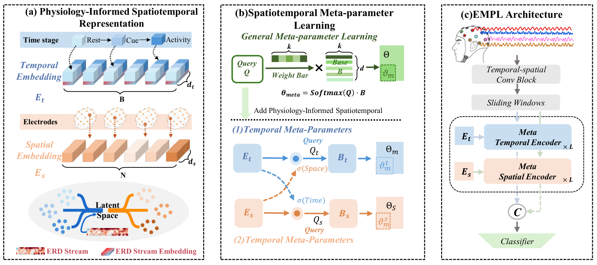
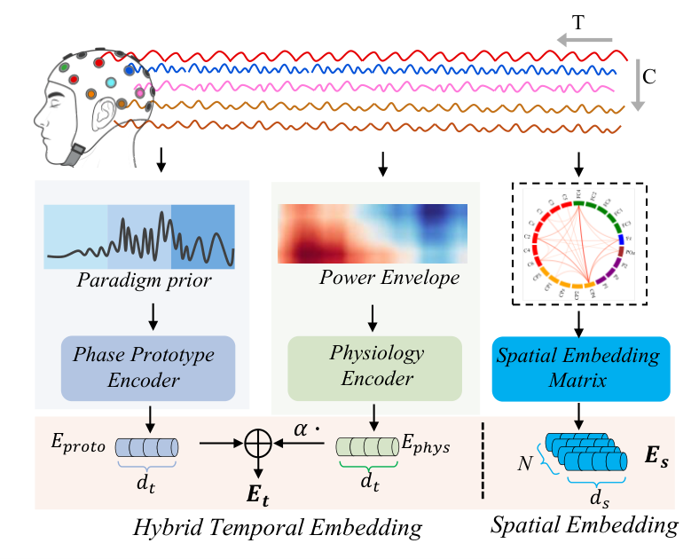
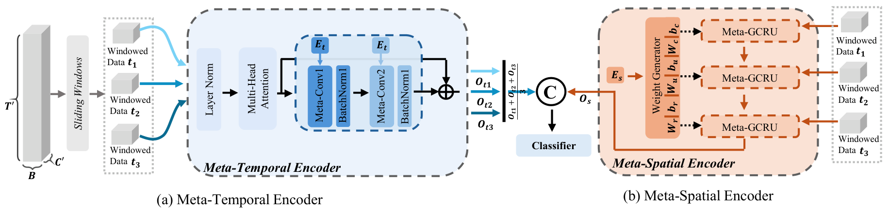
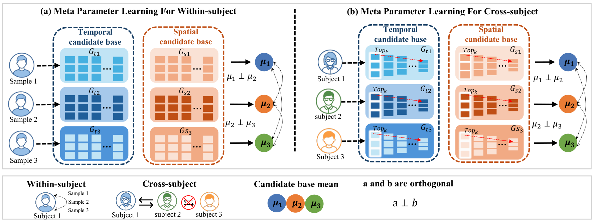

# EMPL

PyTorch implementation of **Embedding-driven Meta-Parameter Learning (EMPL)** for motor-imagery EEG decoding.



## Structure

```
empl/
  embeddings.py   sample-wise hybrid temporal embedding E_t = E_proto + alpha * E_phys, spatial embedding E_s
  meta.py         balanced subspace sampling and group orthogonality loss
  temporal.py     meta-temporal encoder (MHSA + embedding-driven meta-causal convolution, sliding windows)
  spatial.py      meta-spatial encoder (adaptive adjacency from E_s, node-specific Meta-GCRU)
  model.py        EMPL
```

## Sample-wise hybrid temporal embedding



## Meta-temporal and meta-spatial encoders



## Group-based diversity



## Requirements

```
pip install -r requirements.txt
```

## Default settings

d_t = d_s = 64, N_g = 8, tau = 1, J = 2, alpha = 0.3, M = 5 sliding windows of length 16 with stride 1;
Adam, learning rate 9e-4, batch size 64, loss = cross-entropy + 0.2 * group orthogonality loss.
